# Car Anti-Theft System on FPGA

A car anti-theft system designed as a set of interacting finite state machines in SystemVerilog and implemented on a Digilent **Nexys A7-100T** (Artix-7) board with Vivado.

The system arms itself after the driver leaves the car, sounds a siren if a door is opened and the ignition is not turned on in time, and secretly keeps the fuel pump off until the ignition is on and a hidden switch and the brake are pressed together. All four delays can be reprogrammed from the board switches while the system is running.

## Features

- **Eight-state anti-theft FSM** covering the Armed, Triggered, Sound Alarm and Disarmed modes
- **Door-specific countdowns:** 8 s for the driver's door, or 15 s if the passenger's door opens first, so the owner has time to walk around to the driver's side
- **Siren logic:** the siren stays on while any door is open, then for another 10 s once every door is shut; reopening a door restarts that time
- **Automatic arming** 6 s after the driver gets out and all doors are closed; reopening a door restarts the delay
- **Hidden fuel-pump cut-off:** the pump only gets power after the ignition is on *and* the hidden switch and brake are pressed together; holding them before turning the key doesn't work
- **Reprogrammable delays** of 0–15 s each, set from the switches at run time (a 0 s delay works too)
- **Siren output** on an LED plus a 1 kHz square-wave tone on Pmod JA pin 1
- **Clean inputs:** a two-flip-flop synchronizer on every switch and button, plus a 10 ms debouncer on the switches and Reprogram
- **Single 100 MHz clock domain:** the one-second tick is a clock enable, not a divided clock
- **Verified module by module:** eight testbenches, including a full-system run in which 1 µs of simulation equals 1 s in the car

## Board I/O

A switch in the up position reads as 1.

| Signal | Board | Function |
| --- | --- | --- |
| Ignition | SW0 | Up = ignition on |
| Driver's door | SW1 | Up = door open |
| Passenger's door | SW2 | Up = door open |
| Hidden switch | SW3 | Secret switch for the fuel pump |
| Brake pedal | SW4 | Up = brake pressed |
| Time_Value | SW13–SW10 | New delay in seconds (SW13 is the MSB) |
| Time_Parameter_Selector | SW15–SW14 | Number of the delay to change |
| Reprogram | BTNU | Stores Time_Value in the selected delay |
| Reset | BTNC | Restores the default delays and arms the system |
| Status indicator | LD0 | Blinks when armed; steady during the countdown and the alarm |
| Siren | LD1, JA1 | LED on during the alarm; 1 kHz tone on Pmod JA pin 1 |
| Fuel pump power | LD2 | On when the fuel pump has power |
| FSM state | LD15–LD13 | Current anti-theft state number in binary |
| Clock | E3 | 100 MHz on-board oscillator |

### Programmable delays

| Interval | Symbol | Selector (SW15–SW14) | Default |
| --- | --- | --- | --- |
| Arming delay | `T_ARM_DELAY` | `00` | 6 s (`0110`) |
| Countdown, driver's door | `T_DRIVER_DELAY` | `01` | 8 s (`1000`) |
| Countdown, passenger's door | `T_PASSENGER_DELAY` | `10` | 15 s (`1111`) |
| Siren on-time | `T_ALARM_ON` | `11` | 10 s (`1010`) |

To change a delay, set SW15–SW14 to its number, set SW13–SW10 to the new value in seconds, and press **BTNU**. Pressing Reprogram also returns the anti-theft FSM to ARMED. **BTNC** restores all four defaults.

## Architecture

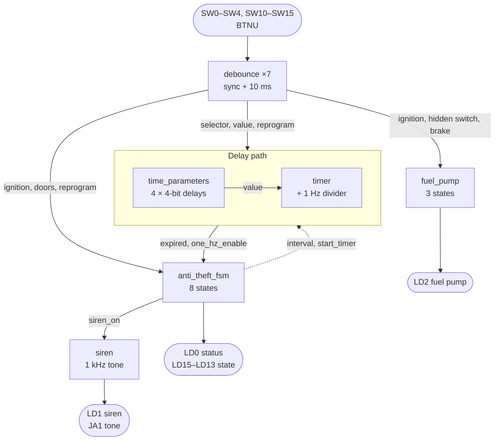

The anti-theft FSM chooses which delay it needs (`interval`), the time-parameter memory returns its value, and the timer loads it on `start_timer` and raises `expired` when it reaches zero. The reset button (BTNC) passes through its own two-flip-flop synchronizer that powers up at 1, so the whole design also resets itself right after the FPGA is programmed.

| Module | File | Role |
| --- | --- | --- |
| `anti_theft_top` | `src/anti_theft_top.sv` | Top level: reset synchronizer, seven debouncers and all the modules below |
| `debounce` | `src/debounce.sv` | Two-flip-flop synchronizer plus a counter that passes a new value only after 10 ms of stability; the width is a parameter, so the six programming switches share one instance |
| `divider` | `src/divider.sv` | One-cycle `one_hz_enable` pulse every 100,000,000 clocks |
| `timer` | `src/timer.sv` | Loads a 4-bit value, counts down on every 1 Hz tick and holds `expired` high at zero; restarts the divider on every start so the first second is always a full second |
| `time_parameters` | `src/time_parameters.sv` | Four 4-bit registers holding the delays; loads the defaults on reset and writes Time_Value on Reprogram |
| `anti_theft_fsm` | `src/anti_theft_fsm.sv` | Eight-state alarm controller; selects the delay, starts the timer and drives the status LED, siren enable and state LEDs |
| `fuel_pump` | `src/fuel_pump.sv` | Three-state hidden fuel-pump FSM |
| `siren` | `src/siren.sv` | Drives the siren LED and a 1 kHz square wave (toggles every 50,000 clocks) |

## State machines

### Anti-theft FSM

  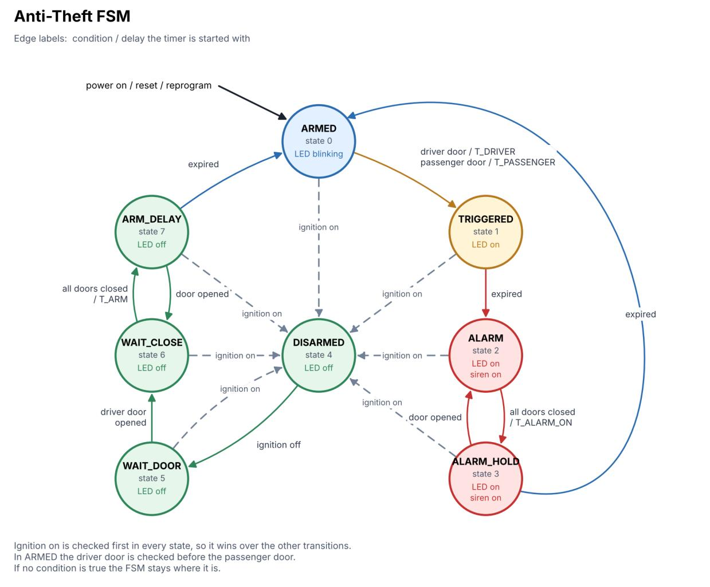

- **Armed (0):** LD0 blinks. Opening the driver's door starts `T_DRIVER_DELAY`; opening only the passenger's door starts the longer `T_PASSENGER_DELAY`.
- **Triggered (1):** the countdown is running. Turning the ignition on disarms the system; if the countdown runs out first, the alarm sounds. Closing the door again does not stop the countdown.
- **Sound alarm (2, 3):** ALARM waits while any door is open. Once every door is closed, ALARM_HOLD keeps the siren on for `T_ALARM_ON`, then returns to ARMED. Reopening a door goes back to ALARM, so the full siren time starts over.
- **Disarmed (4–7):** waits for the ignition to turn off (DISARMED), for the driver's door to open (WAIT_DOOR) and for every door to close (WAIT_CLOSE), then counts `T_ARM_DELAY` (ARM_DELAY) and arms the system. A door opened during the delay restarts it.

Turning the ignition on takes every state straight to DISARMED, and Reset or Reprogram forces ARMED. In ARMED the driver's door is checked before the passenger's door.

| State | Code (LD15–LD13) | Mode | Status LED | Siren |
| --- | --- | --- | --- | --- |
| ARMED | `000` | Armed | Blinking (2 s period) | Off |
| TRIGGERED | `001` | Triggered | On | Off |
| ALARM | `010` | Sound alarm | On | On |
| ALARM_HOLD | `011` | Sound alarm | On | On |
| DISARMED | `100` | Disarmed | Off | Off |
| WAIT_DOOR | `101` | Disarmed | Off | Off |
| WAIT_CLOSE | `110` | Disarmed | Off | Off |
| ARM_DELAY | `111` | Disarmed | Off | Off |

### Fuel pump FSM

  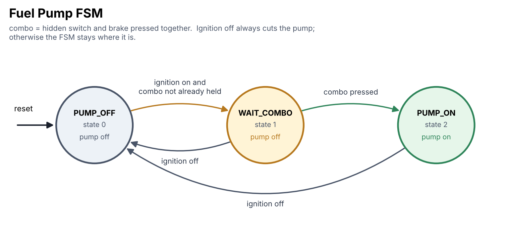

Turning the ignition off always returns the FSM to PUMP_OFF. With the ignition on, it waits in WAIT_COMBO until the hidden switch and the brake are pressed together, then stays in PUMP_ON until the ignition goes off. A combination that is already held when the ignition comes on is ignored, so a thief can't hold both down and then turn the key.

## Try it on the board

Start with every switch down, then work through these steps in order. LD15–LD13 show the state number.

1. **Arm:** press BTNC (or just program the board). LD0 blinks and the state is `000`.
2. **Break-in:** raise SW1 (driver's door) and leave SW0 down. LD0 turns steady (`001`). After 8 s, LD1 lights and the tone starts on JA1 (`010`).
3. **Door closed during the alarm:** lower SW1. The siren keeps going for 10 s (`011`) and the system re-arms (`000`). Raising SW1 during those 10 s goes back to `010`, and the 10 s start again once the door closes.
4. **Owner gets in:** raise SW1, then raise SW0 within 8 s. LD0 turns off (`100`). Lower SW1.
5. **Start the engine:** with SW0 still up, raise SW3 and SW4 so both are up at the same time. LD2 turns on and stays on after you lower them.
6. **Owner leaves:** lower SW0 (LD2 turns off, `101`), then raise and lower SW1 (`110` → `111`). Six seconds later the system re-arms (`000`).
7. **Hot-wire attempt:** raise SW0 and SW4 but not SW3. Turning the ignition on disarms the alarm (`100`), but LD2 never turns on, so the car can't be driven. Lower SW0 and SW4, then press BTNC to re-arm.
8. **Combination held before the key:** raise SW3 and SW4 first, then SW0. LD2 stays off until you lower SW3 and SW4 and raise them again. Lower all three and press BTNC.
9. **Passenger's door first:** raise SW2 only. The countdown is 15 s instead of 8 s. Lower SW2 and let the siren finish.
10. **Reprogram:** set SW15–SW14 to `01` and SW13–SW10 to `0010`, then press BTNU. Opening the driver's door now gives only 2 s before the siren. Lower SW1 and press BTNC to restore the defaults.

## Simulation

Every module was simulated on its own before integration, and `tb_anti_theft_top` then runs the whole system. The real delays are seconds long, far too slow to simulate at 100 MHz, so each testbench overrides the timing parameters (`DELAY`, `CLK_FREQ`, `DB_DELAY`, `TONE_HALF`) to compress time.

| Testbench | Time scaling | What it checks |
| --- | --- | --- |
| `tb_debounce` | `DELAY=10` | Bouncy on and off transitions each give one clean edge; a short glitch never reaches the output |
| `tb_divider` | `CLK_FREQ=10` | One-cycle pulse every 10 clocks; a reset in the middle of a count restarts the period |
| `tb_timer` | `CLK_FREQ=10` | A 3 s countdown, a 5 s countdown restarted halfway, and loading 0 during a count expires at once |
| `tb_time_parameters` | — | Defaults read back as 6, 8, 15 and 10 s; the driver's delay set to 3 s and the siren time to 0 s; reset restores the defaults |
| `tb_anti_theft_fsm` | timer stubbed | All eight states: owner disarming and re-arming, a thief's alarm with the door reopened during the siren, the passenger's door first, a guest reopening a door during the arming delay, and Reprogram during the alarm |
| `tb_fuel_pump` | — | The owner's sequence, a thief pressing only the brake, and a combination held before the key that must be pressed again |
| `tb_siren` | `TONE_HALF=4` | The LED follows `siren_on`; the tone toggles every 4 clocks and stops as soon as the siren turns off |
| `tb_anti_theft_top` | `CLK_FREQ=100` | The complete system through the everyday scenarios below |

### Full-system simulation

`CLK_FREQ = 100`, `DB_DELAY = 5` and `TONE_HALF = 5`, so **1 µs on the waveform equals 1 s in the car**.

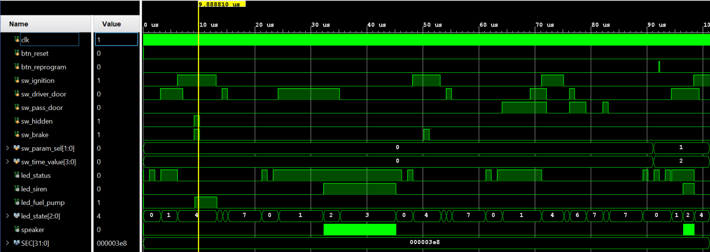

| Time (µs) | Event | `led_state` |
| --- | --- | --- |
| 0–3 | Armed after reset, LD0 blinks | 0 |
| 3–6 | Owner opens the driver's door and turns the key in time | 1 → 4 |
| 9–13 | Hidden switch and brake turn the fuel pump on; it stays on until the key is turned off | 4 |
| 13–21 | Owner gets out and closes the door; the alarm arms 6 s later | 5 → 6 → 7 → 0 |
| 24–45 | Thief opens the door: siren at 32 µs (8 s later), door closed at 35 µs, siren off 10 s later | 1 → 2 → 3 → 0 |
| 48–51 | Thief turns the ignition and presses the brake: disarmed, but the fuel pump stays off | 4 |
| 53–61 | Leaves the car and the alarm re-arms | 5 → 6 → 7 → 0 |
| 64–71 | Passenger's door opened first (15 s countdown), key turned in time | 1 → 4 |
| 75–89 | Both get out; a door reopened at 82 µs restarts the arming delay | 5 → 6 → 7 → 6 → 7 → 0 |
| 92 | `T_DRIVER_DELAY` reprogrammed to 2 s | 0 |
| 94–98 | Driver's door: siren after only 2 s, then the key turns it off | 1 → 2 → 4 |

Module-level waveforms

**`tb_debounce`**: `clean` changes only after the input has been steady for 10 clocks, and the glitch at 810 ns is ignored.

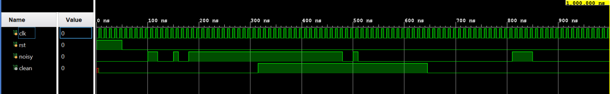

**`tb_divider`**: `one_hz_enable` is high for one clock every 10 clocks; the reset at 550 ns restarts the count.

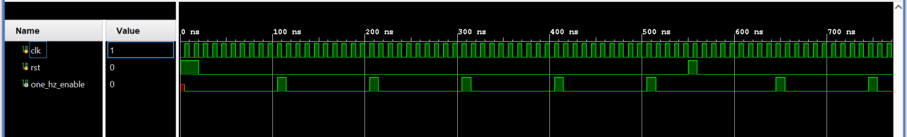

**`tb_timer`**: the 3 s countdown expires 300 ns after `start_timer`, the restarted 5 s countdown 500 ns after the restart, and loading 0 expires at once.

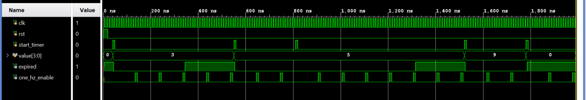

**`tb_time_parameters`**: `value` reads back the defaults 6, 8, f and a (15 and 10); after reprogramming it shows 3 for the driver's delay and 0 for the siren time, and the reset at 300 ns brings the defaults back.

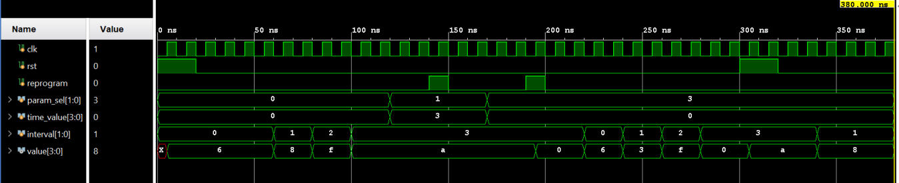

**`tb_anti_theft_fsm`**: visits all eight states; `status_led` blinks only in state 0 and `siren_on` is high only in states 2 and 3.

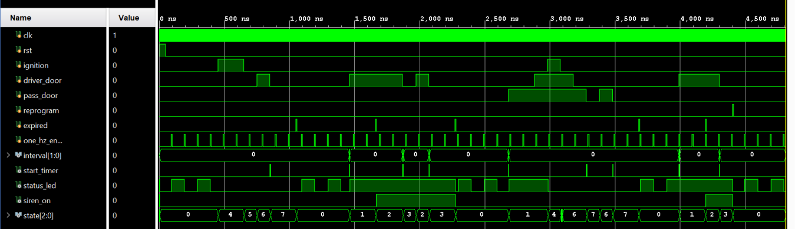

**`tb_fuel_pump`**: the owner's sequence turns `pump_power` on until the ignition goes off; the brake alone does nothing; a combination held before the key must be pressed again.

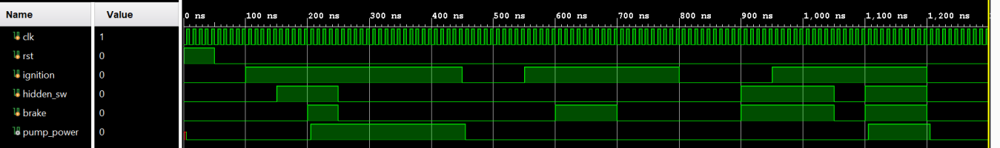

**`tb_siren`**: `siren_led` follows `siren_on`, and `speaker` toggles every 4 clocks while the siren is on.

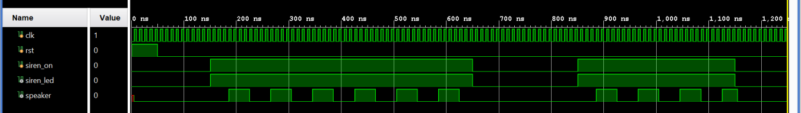

## Implementation results

Post-implementation results on the `xc7a100tcsg324-1` with a 100 MHz clock constraint. Synthesis, implementation and bitstream generation all complete successfully.

| Metric | Result |
| --- | --- |
| LUTs | 130 (< 1%) |
| Flip-flops | < 1% |
| I/O | 21 pins (10%) |
| Global clock buffers | 1 (3%) |
| Worst setup slack (WNS) | +4.434 ns |
| Worst hold slack (WHS) | +0.177 ns |
| Failed routes | 0 |
| Total on-chip power | 0.100 W (0.097 W static, 0.003 W dynamic) |
| Junction temperature | 25.5 °C |

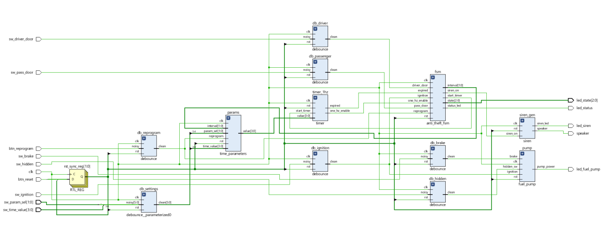

Synthesized schematic and power report

After synthesis every port has an input or output buffer, and the clock goes through a global buffer.

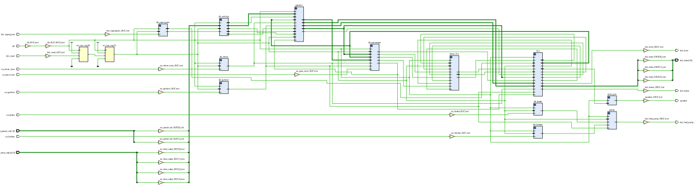

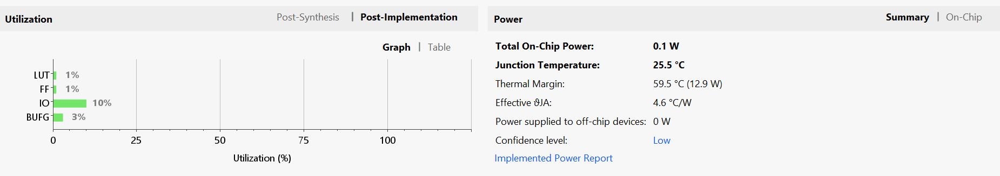

  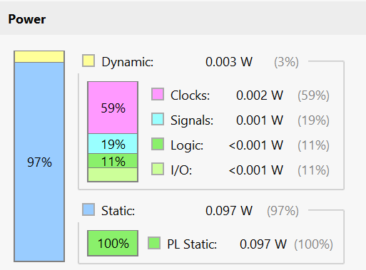

## Design notes

- **Metastability and switch bounce.** A switch can change inside a flip-flop's setup/hold window, and one flip of a mechanical switch looks like several quick changes. Two flip-flops give a metastable value a full clock cycle to settle, and the 10 ms debouncer turns each bouncy transition into one clean edge, so the FSMs only ever see clean, clock-aligned signals.
- **Clock enable, not a divided clock.** The divider produces a one-cycle `one_hz_enable` pulse, so every register stays on the 100 MHz clock and the design avoids the timing problems of a derived clock. The same pulse toggles the blink register, giving LD0 its 2 s period.
- **A full first second.** `start_timer` also resets the divider, so a countdown never loses part of its first second.
- **Zero-second delays.** `expired` is simply `count == 0`, so a delay programmed to 0 ends on the next clock.
- **Extra states where a mode needs to wait.** The alarm is split into ALARM and ALARM_HOLD so `T_ALARM_ON` only starts once every door is shut, and arming is split into WAIT_DOOR, WAIT_CLOSE and ARM_DELAY so the delay restarts if a door reopens.
- **No pre-held combination.** The fuel-pump FSM only leaves PUMP_OFF when the hidden switch and brake are *not* both held, so they must be pressed after the key is turned.
- **Simulation-friendly parameters.** The clock frequency, debounce time and tone period are parameters (`CLK_FREQ`, `DB_DELAY` and `TONE_HALF` at the top level), so the testbenches shrink a second to 10–100 clock cycles without touching the RTL.

